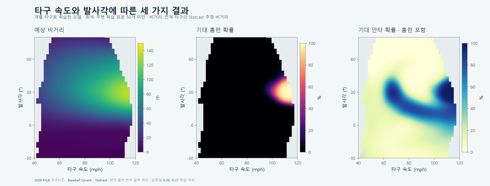
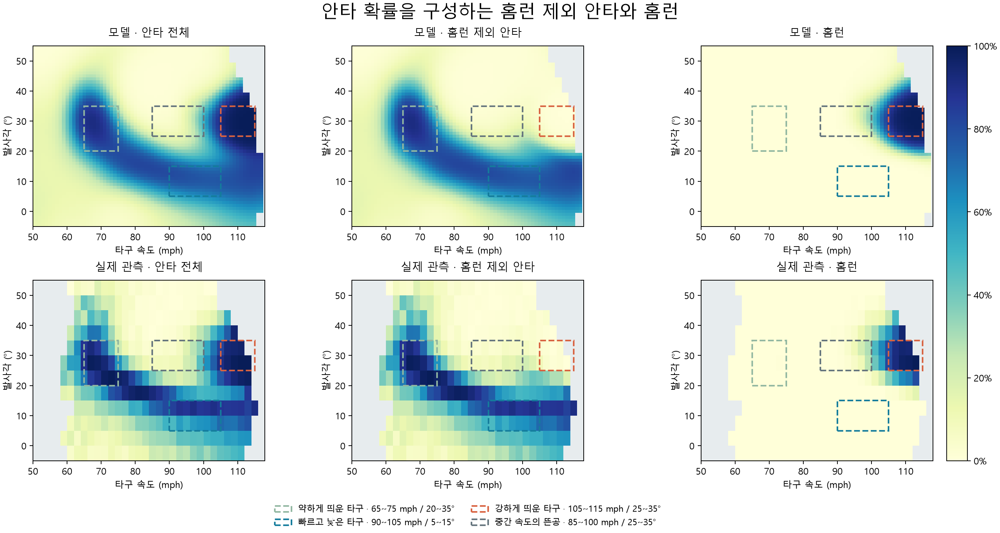
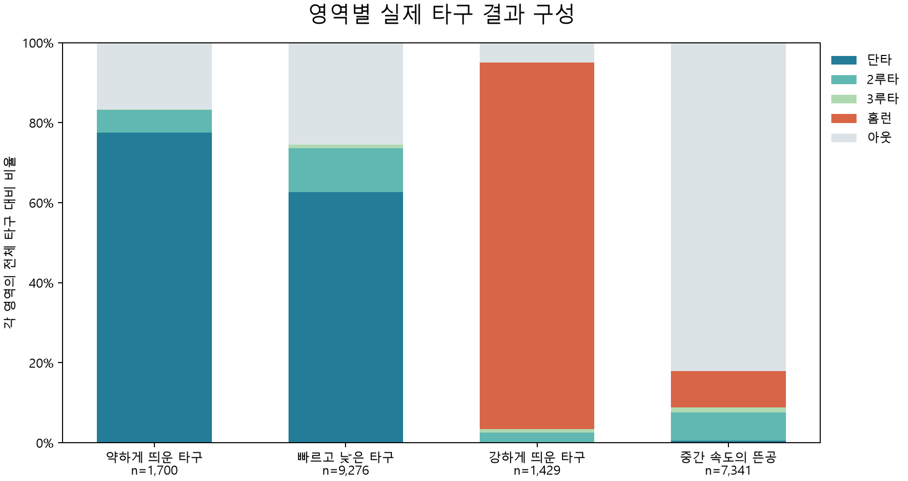

야구에서 타구 속도와 발사각이 중요하다는 이야기를 자주 접했다. 실제로 두 조건에 따라 비거리와 안타·홈런 확률이 어떻게 달라지는지 궁금해 2026년 MLB 데이터를 살펴봤다.

## 전체 타구의 안타와 홈런

| 타구 결과 | 타구 수 | 전체 타구 중 비중 |
| --- | --- | --- |
| 아웃 | 83,271 | 68.0% |
| 홈런 제외 안타 | 33,699 | 27.5% |
| 홈런 | 5,570 | 4.5% |

<iframe src="../scripts/statcast-dashboard.html" title="타구 속도와 발사각에 따른 비거리·홈런·안타 확률" loading="lazy" style="width:100%;height:1600px;border:0;border-radius:14px;"></iframe>

타구 속도가 높아질수록 예상 비거리가 길어지는 모습은 비교적 분명했다. 반면 안타 확률은 속도만으로 설명되지 않았다. 약한 타구에서도 안타 확률이 높은 조합이 있었고, 어느 정도 빠르게 날아간 타구에서도 안타 확률이 낮은 조합이 있었다.

## 안타가 모이는 두 영역

안타 확률을 홈런 제외 안타와 홈런으로 나누면 두 영역의 차이가 더 잘 보인다.

홈런 제외 안타 그래프에는 약하게 띄운 타구와 빠르고 낮게 보낸 타구가 곡선 형태로 이어진다. 강하게 띄운 타구 쪽의 높은 안타 확률은 홈런 그래프에서 두드러진다.

| 비교 구간 | 속도 / 발사각 | 타구 수 | 안타율 | 홈런 제외 안타율 | 홈런율 |
| --- | --- | --- | --- | --- | --- |
| 약하게 띄운 타구 | 65~75 mph / 20~35° | 1,700 | 83.4% | **83.3%** | 0.1% |
| 빠르고 낮은 타구 | 90~105 mph / 5~15° | 9,276 | 74.5% | **74.5%** | 0.0% |
| 강하게 띄운 타구 | 105~115 mph / 25~35° | 1,429 | 95.0% | 3.4% | **91.7%** |
| 중간 속도의 뜬공 | 85~100 mph / 25~35° | 7,341 | **17.9%** | 8.8% | 9.1% |

## 두 영역 사이의 중간 속도 뜬공

중간 속도의 뜬공에서는 7,341타구 중 6,009개에서 아웃이 기록됐다. 약하게 띄운 타구보다 멀리 날아갔지만, 안타율은 약하게 띄운 타구와 강하게 띄운 타구 모두보다 낮았다.

| 비교 구간 | 타구 속도 | 발사각 | 타구 수 | 안타 수·홈런 포함 | 안타율 |
| --- | --- | --- | --- | --- | --- |
| 약하게 띄운 타구 | 65~75 mph | 20~35° | 1,700 | 1,417 | **83.4%** |
| 중간 속도의 뜬공 | 85~100 mph | 25~35° | 7,341 | 1,317 | **17.9%** |
| 강하게 띄운 타구 | 105~115 mph | 25~35° | 1,429 | 1,358 | **95.0%** |

중간 속도로 띄운 공은 약한 타구보다 멀리 가지만, 강한 타구처럼 담장을 넘기기는 어렵다. 하지만 외야수가 도달할 수 있는 반경에 공이 날아가고, 날아가는 동안 이동할 시간도 더 주기 때문에 잡기 쉬운 타구가 되는 것으로 보인다.

속도뿐 아니라 각도의 차이도 살펴봤다. 같은 100 mph 타구에서도 발사각에 따라 결과가 달랐다.

| 100 mph에서의 발사각 | 예상 비거리 | 기대 홈런 확률 | 기대 안타 확률 |
| --- | --- | --- | --- |
| 10° | 58.3 m | 0.0% | **76.8%** |
| 30° | **117.1 m** | **41.7%** | 51.6% |
| 45° | 97.1 m | 2.2% | **3.8%** |

## 무라카미의 타구 속도·발사각과 홈런

이번 시즌 무라카미는 볼넷으로 걸어나가거나, 강하게 때려 홈런을 만드는 것을 목표로 하는 타자처럼 보였다. 그의 타구가 리그 전체의 속도·각도 분포에서 어디에 놓이는지, 홈런은 어떤 조합에서 나왔는지 살펴봤다.

역시 무라카미는 약하게 띄워 안타를 만드는 쪽보다 강한 타구를 만드는 쪽에 가까웠다.

<iframe src="../scripts/murakami-dot-plot.html" title="무라카미의 타구 속도·발사각과 실제 결과" loading="lazy" style="width:100%;height:1050px;border:0;border-radius:14px;"></iframe>

| 타구 구분 | 타구 수 | 평균 타구 속도 | 평균 발사각 |
| --- | --- | --- | --- |
| 전체 타구 | 257 | 93.9 mph | 15.6° |
| 안타 전체 | 94 | 101.3 mph | 19.1° |
| 홈런 제외 안타 | 59 | **98.0 mph** | **10.7°** |
| 홈런 | 35 | **106.8 mph** | **33.3°** |

홈런 제외 안타도 평균 속도가 높은 타구였지만, 홈런보다 낮은 각도로 날아갔다. 홈런 타구는 더 빠르고 높게 날아갔다.

### 리그 전체와의 비교

리그 전체와 무라카미를 같은 타구 결과별로 비교했다.

| 타구 구분 | 리그 평균 속도 | 무라카미 평균 속도 | 리그 평균 발사각 | 무라카미 평균 발사각 |
| --- | --- | --- | --- | --- |
| 전체 타구 | 88.7 mph | **93.9 mph** | 13.9° | 15.6° |
| 안타 전체 | 93.9 mph | **101.3 mph** | 12.0° | 19.1° |
| 홈런 제외 안타 | 92.2 mph | **98.0 mph** | 9.2° | 10.7° |
| 홈런 | 104.0 mph | **106.8 mph** | 29.1° | **33.3°** |

무라카미는 홈런뿐 아니라 홈런 제외 안타에서도 리그 평균보다 타구 속도가 높았다. 따라서 약하게 쳐서 안타를 만드는 쪽보다 강하게 때려 홈런을 노리는 타자에 가까웠다.

## 시즌 초와 마지막 날의 타구 변화

정규시즌 초인 3월 26일과 정규시즌 마지막 날인 9월 27일의 타구를 따로 남겨두고, 속도·발사각과 안타·홈런 결과를 비교했다. 시즌 초와 마지막 날의 타구 경향이 달라졌는지 확인하였다.

| 항목 | 3월 26일 | 9월 27일 |
| --- | --- | --- |
| 경기 / 타구 수 | 11경기 / 542타구 | 14경기 / 704타구 |
| 평균 타구 속도 | **89.7 mph** | **88.7 mph** |
| 평균 발사각 | **13.2°** | **15.3°** |
| 95 mph 이상 타구 비중 | 41.9% | 39.2% |
| 실제 안타율 · 타구 기준 | 35.1% | 31.0% |
| 평균 예측 안타 확률 | 33.2% | 31.2% |
| 실제 홈런율 · 타구 기준 | 5.7% | 5.3% |
| 평균 예측 홈런 확률 | 5.6% | 4.9% |

마지막 날에는 타구 속도와 강한 타구의 비중이 낮아지고, 발사각은 높아졌다. 안타율은 낮아졌지만 홈런율의 차이는 작았다. 두 날짜 사이에서는 공을 더 높이 띄우는 모습과 함께 안타가 줄어드는 변화가 나타났다. (하루 데이터라서 조금 더 구간을 넓게 보는 것도 필요할 수 있음)

## 마무리

타구 속도가 빠르면 좋은 결과가 나올 것이라 생각했지만, 안타는 속도와 각도의 조합에 따라 달라졌다. 약하게 띄운 공과 빠르고 낮게 보낸 공은 주로 단타로, 강하게 띄운 공은 홈런으로 이어졌다. 얼마나 세게 치느냐만큼 어떤 각도로 보내느냐도 중요했다.

### 분석 데이터 출처

타구 데이터는 [Baseball Savant의 Statcast Search](https://baseballsavant.mlb.com/statcast_search)에서, 무라카미의 시즌 기록은 [MLB 공식 기록](https://statsapi.mlb.com/api/v1/people/808959/stats?stats=season&group=hitting&season=2026&gameType=R)에서 가져왔다.
