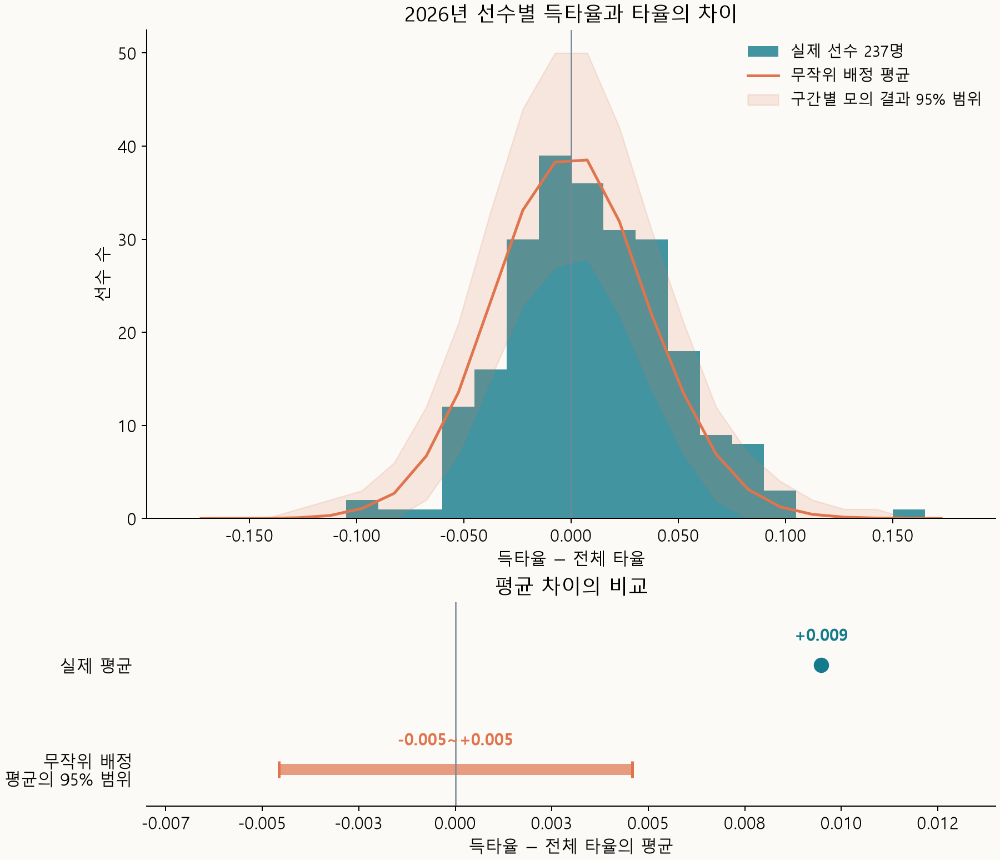
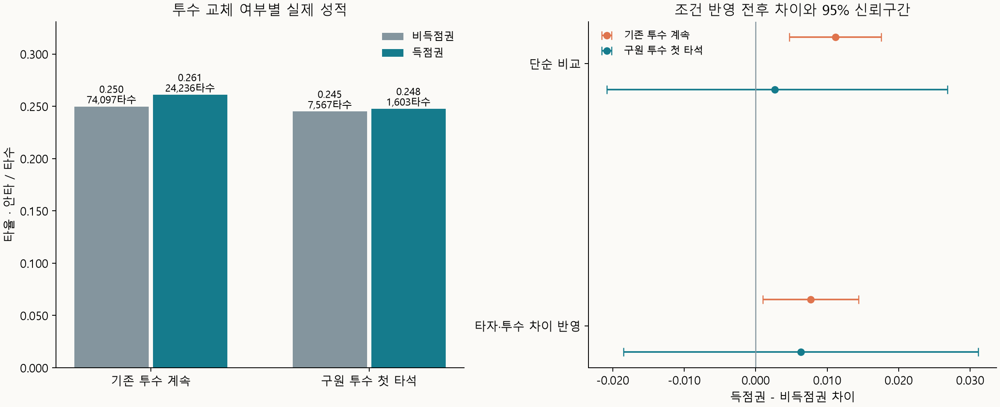
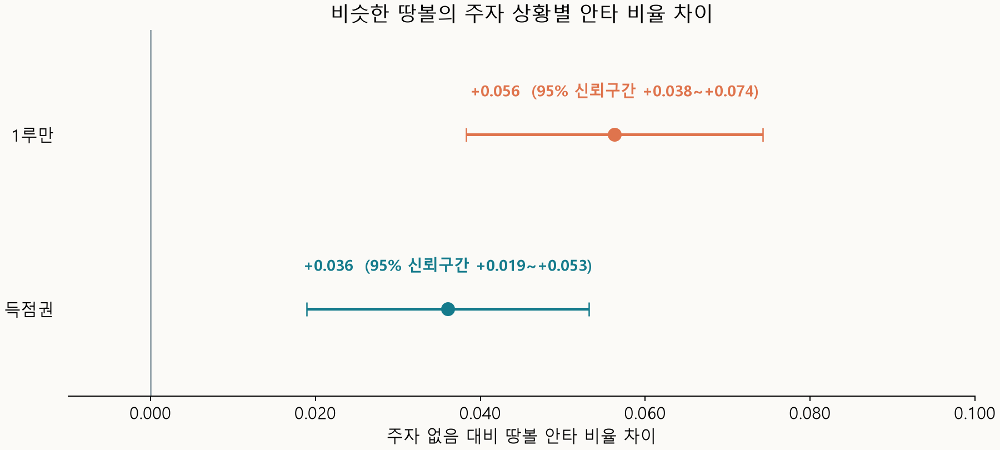

득점권 타율(득타율)과 그냥 일반적인 타율은 다른 지표가 될지 알아보자. 득점권 타율은 단지 주자가 득점권에 있을 때 수집된 타격 결과라고 생각할 수도 있다. 아니면 더 결정적일 상황일때 작용하는 타자의 성적으로 생각할 수도 있다. 주자가 득점권에 있다는 이유로 성적이 달라지는지 알아보자.

## 타율과 득타율의 차이

2026년 타율과 득타율 차이를 비교했다.

선수들의 차이를 평균 내면 득타율이 타율보다 **0.009 높았다.**

안타가 득점권에서 우연히 더 나오거나 덜 나오는 경우와도 비교했다. 이때 선수들의 평균 차이가 어느 정도까지 생길 수 있는지 살펴봤다.

| 비교 항목 | 득타율 − 전체 타율의 평균 |
| --- | --- |
| 실제 2026년 | **+0.009** |
| 우연으로 예상한 평균 차이의 95% 범위 | **−0.005~+0.005** |

실제 타율과 득타율의 차이는 있었다!

차이가 생길 수 있는 이유로 세 가지를 생각하고, 각각 따로 살펴봤다.

- 희생플라이를 타수에서 제외하는 타율 계산 방식
- 주자가 쌓일 당시의 투수 상태
- 주자에 따른 수비 위치 변화

## 희생플라이를 아웃으로 계산한 차이

희생플라이는 아웃이지만 타율 계산에서는 타수에 포함되지 않는다. 주자가 홈으로 들어와야 하므로 득점권에서 발생한다. 따라서 이 아웃을 빼주는 영향은 전체 타율보다 득타율이 더 높게 나타날 수 있다.

희생플라이를 일반 아웃처럼 타수에 넣어, 같은 선수들의 전체 타율과 득타율을 다시 계산했다.

| 시즌 | 기존 평균 차이 | 희생플라이를 아웃으로 계산한 평균 차이 | 계산 변경 후 95% 신뢰구간 |
| --- | --- | --- | --- |
| 2025년 | **+0.012** | **+0.006** | +0.001~+0.010 |
| 2026년 | **+0.009** | **+0.003** | −0.002~+0.008 |

득타율이 높게 나타나는 데에는 희생플라이를 타수에서 제외하는 계산 방식이 꽤 영향을 주고 있었다.

2026년에는 희생플라이를 아웃으로 계산하면, **득타율이 타율과 비슷했다.** 단, 2025년에는 차이가 있었고 득점권에서는 팀배팅을 위해 희생플라이를 더 노렸을 수도 있다.

## 투수 상태에 따른 차이

투수 상태가 득점권 성적에 영향을 줄 수 있는지도 살펴봤다. 주자가 쌓여 있다는 것은 투수 상태가 상대적으로 좋지 않다는 신호일 수도 있다고 생각했다. 그런 투수가 계속 던진다면 뒤의 타자도 안타를 치기 쉬울 수 있다.

2026년 기존 투수가 계속 던지는 타석과 구원 투수가 등판해 처음 상대하는 타석을 비교했다.

| 상대 투수 | 비득점권 타율 | 득타율 | 득점권 − 비득점권 차이 |
| --- | --- | --- | --- |
| 기존 투수가 계속 던진 경우 | 0.250 | 0.261 | **+0.011** |
| 구원 투수가 처음 상대한 타석 | 0.245 | 0.248 | **+0.003** |

기존 투수가 계속 던질 때는 득점권 성적이 더 높았고, 교체 직후에는 차이가 뚜렷하지 않았다. 다만 투수 교체할때는 타자에 맞게 교체를 하니 상대적으로 투수에 유리한 상황이었다.

## 주자에 따른 수비 위치 변화

주자가 발생하게 되면 견제나 홈 승부를 위해 수비 위치가 달라지고 제약이 생기는 것도 득타율과 타율의 차이에 영향을 줄 수 있다. 비슷한 땅볼이지만 주자가 있을 때 더 자주 안타가 되는지 비교했다.

2026년 땅볼을 주자 없음·1루만·득점권으로 나눠 비교해보았다.

| 주자 상황 비교 | 땅볼 안타 비율 차이 | 95% 신뢰구간 |
| --- | --- | --- |
| 1루만 − 주자 없음 | **+0.056** | +0.038~+0.074 |
| 득점권 − 주자 없음 | **+0.036** | +0.019~+0.053 |

비슷한 땅볼도 주자가 있을 때 더 자주 안타가 되었다. 수비 위치 변화가 영향을 줬을 가능성이 있어보인다.

## 마무리

2026년 선수들의 득타율은 타율보다 평균 **0.009 높았지만, 희생플라이를 아웃으로 계산하면 차이는 0.003로 줄었다.** 타율 계산 방식이 평균 차이의 상당 부분을 설명하고 있었다.

희생플라이를 반영한 뒤 남은 평균 차이가 우연한 변동과 뚜렷하게 구분되지 않았다. 투수가 계속 던질 때 득점권 성적은 꽤 높아졌다. 땅볼만 따로 보면, 주자가 있을 때 안타가 되는 비율은 더 높았다.

### 데이터 출처

[MLB 공식 Stats API](https://statsapi.mlb.com/api/v1/stats?stats=statSplits&group=hitting&season=2026&sitCodes=risp&sportIds=1&gameType=R&playerPool=ALL&limit=10000)의 2025·2026년 정규시즌 기록을 사용했다.

땅볼의 속도·각도·타구 좌표는 [Baseball Savant Statcast](https://baseballsavant.mlb.com/csv-docs)의 2026년 정규시즌 자료를 사용했다.
