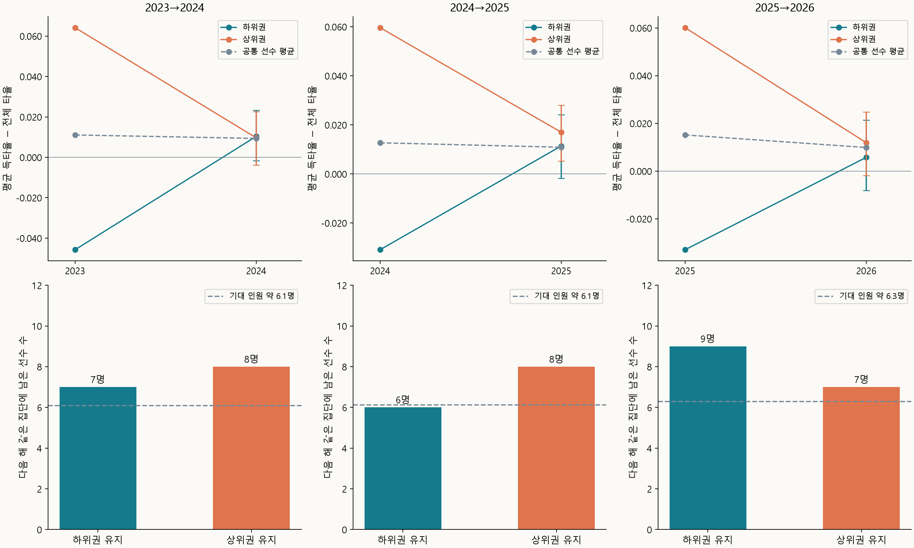

[앞 글](https://choiwonjin55.github.io/blog/mlb-2026-risp-average-gap.html)에서는 득타율이 타율보다 높게 나타나는 이유를 살펴봤다. 이번에는 타율보다 득타율이 높았던 선수가 다음 해에도 같은 모습을 보이는지 알아봤다. 이를 통해 득점권에서 더 잘 치는 것이 선수 개인의 특징으로 나타나는지 판단해보고 싶었다.

시즌마다 전체 300타수와 득점권 75타수 이상을 기록한 선수들을 대상으로, 2023→2024·2024→2025·2025→2026의 세 경우에서 같은 모습이 나타나는지 살펴봤다.

## 득타율이 타율보다 높은 선수들

<iframe src="../scripts/mlb-clutch-season-overview.html" title="2023~2026년 선수별 타율과 득타율 산점도 및 차이의 분포" loading="lazy" style="width:100%;height:1100px;border:0;border-radius:14px;"></iframe>

2026년 분석 대상 237명 중 득타율이 타율보다 높은 선수는 **136명, 57.4%**였다. 낮은 선수는 **101명, 42.6%**였다.

앞선 세 시즌에서도 득타율이 타율보다 높은 선수가 절반 이상이었다.

| 시즌 | 분석 대상 | 득타율이 타율보다 높은 선수 | 비율 | 95% 신뢰구간 |
| --- | --- | --- | --- | --- |
| 2023년 | 236명 | **137명** | **58.1%** | 51.7~64.2% |
| 2024년 | 235명 | **144명** | **61.3%** | 54.9~67.3% |
| 2025년 | 238명 | **146명** | **61.3%** | 55.0~67.3% |
| 2026년 | 237명 | **136명** | **57.4%** | 51.0~63.5% |

득타율이 타율보다 높은 선수의 비율은 매년 **57~61%**였다. 연도에 따른 차이는 통계적으로 뚜렷하지 않았다(**p=0.750**).

매년 비슷한 비율로 나타났다면, 같은 선수들이 다음 해에도 높은 쪽에 남았는지 살펴볼 필요가 있었다.

## 다음 해에도 높은 선수들

두 시즌 모두 타수 기준을 충족한 선수는 2023→2024에 **158명**, 2024→2025에 **157명**, 2025→2026에 **163명**이었다.

| 비교 시즌 | 전년도 구분 | 선수 수 | 다음 해 득타율이 타율보다 높은 선수 | 무작위 기대 인원 |
| --- | --- | --- | --- | --- |
| 2023→2024 | 높았던 선수 | 98명 | **55명** | 약 57.1명 |
| 2023→2024 | 낮았던 선수 | 60명 | **37명** | 약 34.9명 |
| 2024→2025 | 높았던 선수 | 99명 | **62명** | 약 59.9명 |
| 2024→2025 | 낮았던 선수 | 58명 | **33명** | 약 35.1명 |
| 2025→2026 | 높았던 선수 | 106명 | **61명** | 약 60.5명 |
| 2025→2026 | 낮았던 선수 | 57명 | **32명** | 약 32.5명 |

모든 비교에서도 실제 인원은 기대 인원과 가까웠다. 전년도에 높았다는 구분이 다음 해에도 이어지는 모습은 세 비교 모두 뚜렷하지 않았다.

## 차이 크기의 연도 간 비교

이번에는 차이의 크기까지 다음 해에 이어지는지 살펴봤다.

<iframe src="../scripts/mlb-clutch-dashboard.html" title="2023~2026년 연속 시즌 세 쌍의 선수별 득점권 타격 비교" loading="lazy" style="width:100%;height:1750px;border:0;border-radius:14px;"></iframe>

| 비교 시즌 | 공통 선수 | 득타율 차이의 연도 간 상관 | 95% 신뢰구간 | 전체 타율의 연도 간 상관 |
| --- | --- | --- | --- | --- |
| 2023→2024 | 158명 | **−0.019** | −0.170~0.134 | **0.442** |
| 2024→2025 | 157명 | **0.062** | −0.098~0.224 | **0.469** |
| 2025→2026 | 163명 | **0.005** | −0.147~0.165 | **0.357** |

같은 선수들의 일반 타율은 상관이 **0.357~0.469**로 어느 정도 이어졌다. 그러나 득타율과 전체 타율 차이의 연도 간 상관은 **−0.019~0.062**로 세 비교 모두 0에 가까웠다.

## 상위권과 하위권의 다음 시즌

차이가 특히 컸던 선수들이 다음 시즌까지 반복되는지도 따로 확인했다. 각 비교의 공통 선수를 전년도의 득타율 차이로 정렬해 상위 20%와 하위 20%를 뽑았다. 각 집단은 2023→2024와 2024→2025에서 **31명**, 2025→2026에서 **32명**이었다.

| 비교 시즌 | 전년도 집단 | 선수 수 | 전년도 평균 차이 | 다음 해 평균 차이 | 다음 해 평균의 95% 신뢰구간 |
| --- | --- | --- | --- | --- | --- |
| 2023→2024 | 상위권 | 31명 | **+0.064** | **+0.010** | −0.004~+0.023 |
| 2023→2024 | 하위권 | 31명 | **−0.046** | **+0.010** | −0.002~+0.023 |
| 2024→2025 | 상위권 | 31명 | **+0.060** | **+0.017** | +0.005~+0.028 |
| 2024→2025 | 하위권 | 31명 | **−0.031** | **+0.011** | −0.002~+0.024 |
| 2025→2026 | 상위권 | 32명 | **+0.060** | **+0.012** | −0.002~+0.025 |
| 2025→2026 | 하위권 | 32명 | **−0.033** | **+0.006** | −0.008~+0.021 |

세 비교 모두 상위권과 하위권의 차이가 줄어들었다.

| 비교 시즌 | 전년도 집단 | 선수 수 | 다음 해 같은 집단에 남은 선수 | 무작위 기대 인원 |
| --- | --- | --- | --- | --- |
| 2023→2024 | 상위권 | 31명 | **8명** | 약 6.1명 |
| 2023→2024 | 하위권 | 31명 | **7명** | 약 6.1명 |
| 2024→2025 | 상위권 | 31명 | **8명** | 약 6.1명 |
| 2024→2025 | 하위권 | 31명 | **6명** | 약 6.1명 |
| 2025→2026 | 상위권 | 32명 | **7명** | 약 6.3명 |
| 2025→2026 | 하위권 | 32명 | **9명** | 약 6.3명 |

다음 해에도 상위권에 남은 선수는 **7~8명**, 하위권에 남은 선수는 **6~9명**이었다. 이 정도의 반복은 선수의 영향이 없다고 판단된다.

## 마무리

전년도에 높았던 선수들이 다음 해에도 높은 쪽에 남는 인원은 무작위 기대 인원과 비슷했다. 차이의 크기도 세 비교 모두 거의 이어지지 않았고, 상하위권의 간격도 다음 해에는 작아졌다.

따라서 득타율이 타율보다 높거나 낮은 모습이 선수 개인의 특징으로 이어지는 경향은 뚜렷하지 않았다.

### 데이터 출처

[MLB 공식 Stats API](https://statsapi.mlb.com/api/v1/stats?stats=statSplits&group=hitting&season=2026&sitCodes=risp&sportIds=1&gameType=R&playerPool=ALL&limit=10000)의 2023~2026년 정규시즌 기록을 사용했다.
