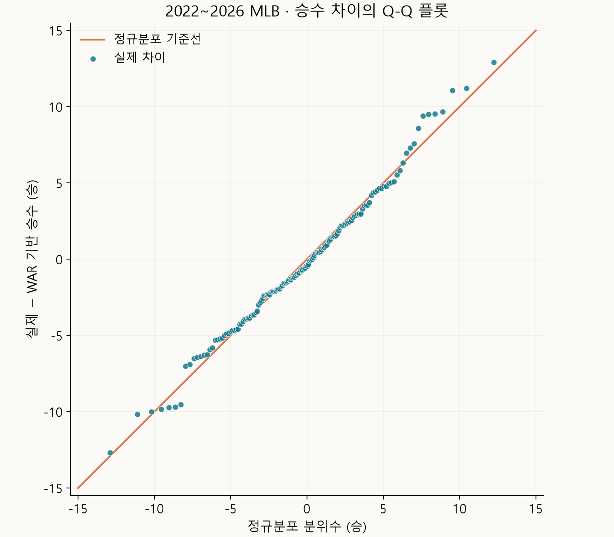

WAR는 선수의 활약을 평가할 때 쓰이는 지표다. 하지만 팀의 승리에는 선수 개인의 역량 외에도 감독의 용병술이나 운, 심판의 판정도 영향을 줄 것 같았다. 선수들의 WAR를 합치면 이런 요소들이 섞인 실제 팀의 승리와 얼마나 잘 맞을지 궁금했다.

2022~2026년 MLB 정규시즌의 30개 팀씩, 총 150개 팀·시즌을 비교했다. WAR는 FanGraphs의 fWAR를 사용했다.

## 팀별 WAR와 실제 승수

WAR는 선수가 대체선수보다 얼마나 더 많은 승리에 기여했는지를 추정하는 지표다.

전체 150개 팀·시즌에서 WAR와 실제 승수의 **상관계수는 0.929**였다. 팀 WAR와 실제 승수는 꽤 잘 맞았다.

<iframe src="../scripts/mlb-war-wins-dashboard.html" title="2022~2026년 MLB 팀 WAR와 실제 승수 및 승수 차이 비교" loading="lazy" style="width:100%;height:760px;border:0;border-radius:14px;"></iframe>

## 연도별 관계

각 시즌에서도 강한 상관성이 나타나는지 나눠서 살펴봤다.

| 시즌 | WAR와 실제 승수의 상관계수 |
| --- | --- |
| 2022년 | **0.981** |
| 2023년 | **0.902** |
| 2024년 | **0.941** |
| 2025년 | **0.921** |
| 2026년 | **0.873** |

매년 30개 팀을 따로 비교해도 상관계수는 **0.873~0.981**이었다.

## WAR로 환산한 승수

이번에는 WAR를 팀 승수로 바꾸면 실제와 얼마나 가까운지 살펴봤다.

[FanGraphs의 설명](https://library.fangraphs.com/getting-started/)에서는 대체선수들로만 구성된 팀도 162경기에서 약 48승을 거둘 것으로 본다. 이를 기준으로 승수를 환산했다.

**WAR 기반 승수 = 48 × 경기 수 ÷ 162 + 팀 WAR**

| 비교 항목 | 전체 150개 팀·시즌 결과 |
| --- | --- |
| 실제 승수와의 평균 절대차이 | **3.65승** |
| 차이가 ±5승 이내인 경우 | **113개, 75.3%** |
| 차이가 ±10승 이내인 경우 | **144개, 96.0%** |

대부분은 실제 승수와 가까웠지만, **10승 넘게 차이 나는 경우도 6개** 있었다. 그중 차이가 큰 다섯 팀·시즌을 골랐다.

| 시즌 | 팀 | 팀 WAR | WAR 기반 승수 | 실제 승수 | 실제 − WAR 기반 |
| --- | --- | --- | --- | --- | --- |
| 2026년 | 애틀랜타 브레이브스 | 33.07 | 81.07승 | 94승 | **+12.93승** |
| 2023년 | 캔자스시티 로열스 | 20.68 | 68.68승 | 56승 | **−12.68승** |
| 2025년 | 클리블랜드 가디언스 | 28.79 | 76.79승 | 88승 | **+11.21승** |
| 2025년 | LA 에인절스 | 12.94 | 60.94승 | 72승 | **+11.06승** |
| 2025년 | 뉴욕 메츠 | 45.15 | 93.15승 | 83승 | **−10.15승** |

## 승수 차이의 분포

150개 팀·시즌의 **실제 승수 − WAR 기반 승수**가 어떤 분포를 이루는지 Q-Q 플롯으로 살펴봤다.

점들은 대체로 기준선을 따랐고, 승수 차이의 분포는 정규분포와 비슷한 모양이었다.

## 마무리

팀 WAR가 높으면 실제 승수도 높았다. WAR는 계산 방식이 꾸준히 보완되어 왔고, 이번 비교에서도 실제 팀 승리와 높은 연관성을 보였다.

### 데이터 출처

팀 WAR는 [FanGraphs 팀 기록](https://www.fangraphs.com/leaders/major-league?pos=all&stats=bat&lg=all&qual=0&type=8&season=2026&season1=2022&ind=1&team=0%2Cts)의 타격·주루·수비 WAR와 투수 WAR를 합쳤다. 승패와 득실점은 [MLB 공식 Stats API](https://statsapi.mlb.com/api/v1/standings?leagueId=103,104&season=2026&standingsTypes=regularSeason)의 2022~2026년 정규시즌 기록을 사용했다. 자료 수집일은 2026년 11월 3일이다.
